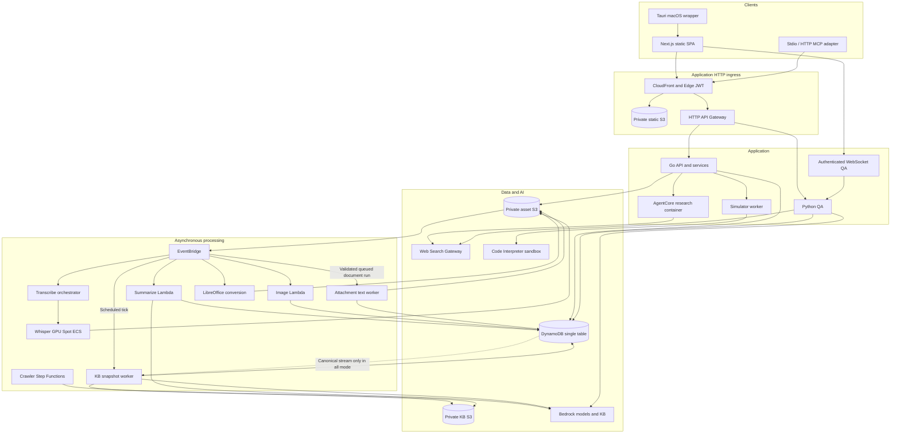

# Architecture

Current component map for the checked-in project. Deployment state requires
independent verification; [infrastructure](INFRA-SPEC.md) records declared gaps.

The diagram groups responsibilities; it is not an exhaustive network-policy
model. Browsers also use authenticated Cognito/Transcribe SDK calls and signed S3
PUTs. The Mac app records a Core Audio system-audio tap mixed with the microphone
(ADR-046); native finished audio uploads stream directly from disk in Rust; live
PCM crosses IPC for captions. The public-document route is the single intentional
unauthenticated application GET and still validates a revocable share token.
Extraction's event target/worker, API producers and summary consumer are wired;
QA/UI activation remains separate. The KB activation configuration retains the
enabled schedule and selects `all`, which adds the dotted canonical stream.
These are repository capabilities and configuration, not assertions about
deployed activation or completed public acceptance.

## Identity onboarding

Cognito identity, the app PROFILE and resource membership are separate states.
The authenticated session bootstrap coordinates profile creation and eligible
pending grants without relying on a meeting-page visit. Project invitations have
a separate user queue plus a project reverse row, keeping older API readers from
consuming unknown grant kinds. Transactions bind project ownership, invitation
version/expiry and recipient sub before publishing membership. JWT email
verification remains required; account roles and global admin rights are never
inherited from a project invitation. See ADR-044 and API-SPEC for contracts.

Deploy and verify the API with `/api/session/bootstrap` and project pending routes
before publishing the new frontend. The new frontend requires bootstrap and will
show retry on an older/missing API. For incompatible API rollback, pause the persistent transactional control row
and drain/cancel project invitations with `prepare-project-invite-rollback`.
Do not retain a project grant across an API version that cannot retire it on
membership changes. The guard must ship before the companion frontend is activated.
Existing account/meeting queue behavior and the project deletion residual storage
race described in ADR-025 remain: deleted projects cannot materialize grants and
unconsumed project invitation rows expire through their existing TTL field.

## Data paths

1. Capture microphone/tab/native system audio. Live captions use browser Transcribe
   Streaming, with guarded fallback/recovery that prioritizes preserving recording.
   Opt-in live interpretation uses the authenticated Translate API. The browser
   keeps each utterance's detected language and stream-scoped result ID, translates
   Korean to English and English to Korean, and renders both columns together.
   Missing language metadata uses the current text's script, never the previous
   utterance's language. The shared translation scheduler bounds pending finals,
   concurrency, UTF-8 request/result sizes and request duration; it rejects stale
   responses after finalization, setting changes or stop. Partial-caption drafts
   are translated only after an explicit opt-in (fast path); finals use the
   validated high-quality interpreter with frozen source context and Amazon
   Translate fallback, and the API applies per-user hourly request limits
   (ADR-005 amendments). Interpretation failures
   do not stop capture. This path does not change batch transcription or saved notes.
   Live translations are not persisted. Readers can translate final AI notes or
   the selected transcript on demand: one `MeetingReadingService` page goes,
   placeholder-protected and without speaker labels or times, through the same
   interpreter path to client memory only (`MEETING_TRANSLATION_ENABLED`, daily
   byte budget).
2. Upload audio to S3. EventBridge invokes the transcribe orchestrator, which uses
   configured Whisper ECS or AWS Transcribe fallback. Multipart completion and
   transcript uploads trigger summarization with concurrency/retry guards.
   Browser chunks also have account-scoped IndexedDB recovery with exclusive
   per-recording Web Locks; a local finalization can defer upload until the next
   visit. Server recovery remains available for expired empty drafts.
   Owner-requested audio cropping creates an independent private meeting through
   a source-checked transaction, then dispatches the existing Whisper worker.
   The worker reads a pinned source revision, cuts the requested bytes and runs
   transcription on that file. Original audio and prior human edits remain intact.
   A 15-minute scheduled tick on the same transcribe Lambda re-drives stuck
   single-file Whisper meetings with conditional, two-attempt claims. It re-runs STT
   only when the GPU cluster is idle, re-drives an unpublished transcript through
   summarize, records `AUDIO_CORRUPT`/`NO_SPEECH`/`WORKER_FAILED` marks, and after
   seven untouched days deletes marked meetings that hold no user data. Checkpoint-only
   and multipart meetings are reported, not processed (ADR-031 amendment).
3. Refine text while preserving acoustic speakers; summarize the selected source,
   saved notes and supported context into editable meeting content. Transcript
   spill objects are rehydrated by repository reads. Stale segments must not
   override selected/edited A/B text. Conditional snapshot writers publish unique
   immutable spill references only with the matching item update; ambiguous
   writes retain new objects. Reader compatibility precedes writer deployment.
   Saved notes remain separately attributed evidence and cannot fabricate speech
   timestamps, decisions or assigned tasks.
   Final notes use the GPT-6.1 Sol summary override. Both providers retain bounded
   continuation after token exhaustion and publish only complete visible text.
   Refinement and auxiliary calls keep their independent model selection.
   Authorized shared readers can correct known speaker names through the bounded
   speaker endpoint with the existing version comparison. General editing and
   owner-only re-diarization retain their separate permissions (ADR-051).
4. Derive account/project material using explicit relations and current access.
   Hierarchy classifies accounts; it never grants membership. Project lists union
   owner, direct membership and linked-account access.
   Meeting detail combines explicit account linking and team publication in one
   existing share request; recording preparation remains private classification.
5. Personal documents support independent account copies, read-only email
   references, PDF preview sidecars and token-revocable public links. These paths
   have different storage/access semantics and must not share meeting share keys.
6. QA retrieves candidates, then rechecks current authorized meeting content.
   Research and QA can call an external search provider. Simulator code runs under
   an empty interpreter role plus SANDBOX networking and receives validated
   requirements/options, not the raw transcript.

The SA workflow connects private preparation documents, initial meeting notes,
authorized reference catalogues, and private follow-up snapshots through existing
APIs. Reference selection never searches or publishes automatically; copied notes
are visible to meeting readers. Recording and detail editors compare note text
and server revisions; audio retry is independent of an acknowledged note save.
Account classification and team publication remain separate. Account meeting and
insight projections recheck current canonical publication with strong metadata
reads before returning stored excerpts. See [workflow](features/sa-meeting-workflow.md).

## New processing and reading contracts

The news enrichment replacement starts with staged, unused discovery, candidate,
article and synthesis modules under `backend/python/crawler/`.
`news_discovery.py` checks actual result dates against seven-day and fallback
30-day windows, bounds query/result counts and encoded candidate output, and
requires complete published-identity reads. Explicit custom URLs receive the
limited slots first and skip relevance filtering; their article fetch and
quality checks still apply. Search snippets and raw transport errors are omitted.
Source fingerprints cover configuration relevant to publication; the future
worker must revalidate them against current configuration before publishing.
Source IDs retain the stored Unicode letters and decimal digits used by the Go
source creator, plus existing hyphens and underscores. Discovery never renames
them and rejects whitespace, path delimiters and the reserved `__` prefix.
Public-source query expansion and URL/event identity are bounded. The article
identity rejects undecodable UTF-8 query octets instead of merging replacement
characters; malformed group members are isolated. Canonical metadata must retain
the normalized fetched origin, including scheme and effective port. The article
reader resolves DNS in an isolated subprocess with a five-second timeout and
reaps stalled children. It tries validated public addresses under the remaining
attempt budget, retains TLS hostname verification (TLS 1.2 minimum), and rechecks
each redirect; credentials, private/transition addresses and non-web ports are
rejected. Explicit supported MIME, matching HTTP/meta charset declarations
(UTF-8, ASCII, EUC-KR or CP949), visible paywall notices even in forms and other
body-excluded containers, encoded/decoded byte limits, receive deadlines and complete-body checks
reject oversized, partial, paywalled or script-only input instead of publishing
snippet-based summaries. Scoped article/container text and nested trailing corrections
are retained even without paragraph tags; the paywall scan is independent of body
boilerplate exclusion. Nonrepresentable UTC dates remain unknown freshness.
`news_enrichment.py` accepts only bounded schema-v1
objects from complete model responses. Each evidence URL/excerpt/date binds to the
same fetched source; facts reference validated evidence, and rejected attempts
retain token accounting. One repair may reuse the complete original sources.
An explicit negative or valid below-threshold relevance verdict ends the attempt even
if other fields are malformed; the relevance gate requires a boolean.
Prompt fields must encode as UTF-8 before any model request. The long-copy
check collapses source and generated whitespace exactly as rendering does.
Accepted citation links retain the exact fetched final URL. `news_renderer.py`
escapes model prose and URL components, preserves retrieval query order and IPv6
authorities, and never receives raw article bodies. Citation provenance checks do
not prove semantic correctness. The injected Bedrock client owns the invocation
region; the model identifier remains explicit configuration.
Frontend activation must also preserve literal IPv6 authority brackets when its
Markdown parser serializes link destinations; valid Markdown alone does not
establish a working rendered link.
Prices are caller-supplied estimates; absent rates do not mean zero cost.
Terms/diagrams remain unavailable until their schema/rendering contracts land.
The staged `news_store.py` adapter transactionally reserves source/run/month
budgets, acquires a unique attempt lease, and publishes accepted document state
with its terminal receipt and cost settlement. Attempts and lookups use
discovery's exact Unicode source ID contract without normalization. Run IDs
retain their separate ASCII constraint. Rejected usage remains charged;
unknown or abandoned usage retains its reservation. Immutable attempt keys live
outside the legacy shared-text prefix. New consumers must verify current
publication state before those writers activate; see
[ADR-052](decisions/ADR-052-conditional-news-publication.md).
The staged `news_worker.py` now joins current source checks, HTTPS-only article
fetches, queued-candidate freshness checks, model accounting, immutable uploads
and conditional publication. Its input boundary uses the same exact Unicode
source IDs as discovery and storage while retaining ASCII run IDs.
A failed lead is never replaced by a corroborating
source; failed or deferred corroboration remains visible in the terminal receipt.
Retrieval retains the original URL query bytes; canonicalization selects identity
only. Unsupported or duplicate optional sources do not reject a valid lead.
Freshness is checked again after the final immutable upload before publication.
Search-provided dates are identified separately from dates extracted from articles.
Renderer rejection settles known cost without uploading. An ambiguous upload or
insufficient settlement time retains the reservation and immutable objects.
Each invocation reserves both maximum input/output model calls before inference,
requires positive caller-supplied rates and counts the actual prompt before each
call. `news_model.py` signs the supported Opus 5 token-count request for the fixed
US East (N. Virginia) Mantle endpoint, with no redirects or application retries.
Isolated DNS resolution and every socket read share one 20-second monotonic
deadline through the pinned-address transport;
Converse remains on the injected regional runtime client. This is an explicit
cross-region AWS service integration using public source material. The ordinary
runtime CountTokens API does not support this model's inference profile; see the
[AWS token-counting contract](https://docs.aws.amazon.com/bedrock/latest/userguide/count-tokens.html).
Activation still requires Mantle/Converse IAM and publication-aware consumers.
`news_runtime.py` supplies private discovery, worker and finalization handlers,
dated positive prices, no-retry SDK clients and invocation-local deadlines.
Writers default off; canary mode accepts only the configured source. Finalization
remains available when writers are disabled. The dedicated `news_search.py`
adapter signs only the configured US East AgentCore Gateway, shares a 20-second
deadline across DNS and socket operations, caps responses at two million bytes
and logs only a query hash on failure. It does not change the three legacy
gateway adapters. A successful token-count probe alone is not production acceptance.
`infra/lib/news-publication.ts` declares an additive private Step Functions
workflow with separate discovery/worker/finalizer/recovery roles, off-by-default
canary configuration, sequential bounded candidate execution and a five-minute
recovery schedule. Worker results retain only bounded identity/status fields;
candidate data is removed before finalization. The legacy daily workflow remains
separate until consumer acceptance and migration. No public route is added.
The CDK declaration and passing tests do not establish live service-role access
or positive QA acceptance; follow the dated news release runbook.
The staged `news_lifecycle.py` starts each source run once, before discovery or
reservation. Reservations require that open run, its exact source revision, a
30-minute admission window and a maximum of 60 attempts. Run counters advance in
the same transactions as reservations and settlements. Finalization strongly
reads bounded attempt rows, rejects live leases, freezes expired attempts and
writes one stable history row atomically with the run receipt. It preserves all
charged cost and records unknown usage; it never increments cost again or updates
source CONFIG. Pre-inference failures supplied by the completed workflow remain
visible even when no model attempt was created. Recovery explicitly marks missing
workflow outcomes and cannot finalize before the admission deadline, even when
no attempt exists. The recovery transaction pins that deadline. Run identities
retain the same exact Unicode source IDs as discovery and publication.
New accounting/run/history rows use the existing table TTL
attribute for 400-day retention; claims expire after seven days. Canonical
published documents and objects have no automatic expiry in this stage.
QA's `news_text.py` now authorizes new `news/v1/` objects against current strong
document/configuration reads, exact immutable attempt keys and SHA-256. It reads
at most 64,000 bytes with ETag/version conditions, checks canonical state again,
and binds continuation and history replay to the combined publication/object
revision. Indexed snippets never replace unavailable current bytes. These news
sources are available to authenticated users; no public route is added. REST and
WebSocket share this reader through source access. An isolated synthetic canary
may qualify publication and both QA transports after readers deploy. Positive
deployed QA acceptance and legacy news migration remain required before enabling
normal source writers or `all` mode.
`news_recovery.py` supplies a private scheduled-recovery handler with a leased,
durable scan cursor. Each invocation reads at most ten 100-item pages and advances
the cursor only after a page is handled. Recovery survives writer rollback and
does not release unknown charges. DynamoDB integer counters keep their JSON
number shape on receipt replay; money is serialized as exact decimal strings.
The web source list labels these results as news evidence and retains partial
and restored-history caveats without exposing internal S3 links. Markdown views,
editable document/meeting HTML and research exports restore valid IPv6 authority
brackets after parser encoding. Query bytes, HTML escaping, URL protocol filtering
and the existing HTML sanitization remain in place.
The Go insights API revalidates news list identities against complete, strongly
consistent document/configuration batches before pagination, including cache hits.
Versioned detail reads require the current publication, exact immutable key and
Markdown SHA-256 before returning at most 64,000 UTF-8 bytes. Missing metadata
never falls back to an orphan object. Legacy reads retain only bounded `shared/`
keys. Source revisions match the Python contract, including literal Unicode.
The disabled-source and revision gates apply to versioned publications. Legacy
news remains readable after its last subscriber leaves, and existing AWS technical
articles retain the exact `__tech__` partition. Publication titles follow the
producer's trimmed length and line-whitespace rules without relaxing source IDs
or source-fingerprint validation.
Display metadata trims title and tag outer padding after canonical validation,
preserving raw stored bytes for publication identity and delete conditions while
keeping the 24,000-byte metadata response limit.
Repository Query/Scan results decode document records individually, so a malformed
record does not hide valid neighbors or discard the storage continuation key.
Single-record decode errors have a distinct sentinel. Both legacy and versioned
news details apply the bounded current metadata projection; malformed or oversized
metadata is unavailable, and list projection omits only that record.
Storage read failures still fail the service request, and deletion retains raw identity.
Owner/admin deletion transactionally marks a versioned publication `DELETED`
before deleting its two immutable objects; retained tombstones support cleanup
retries. Both writer reservation and publication preserve deleted/unknown-schema
rows. Discovery excludes tombstones before its visible count, following source
Query continuation under the list service's 20-second deadline. The transaction
checks current ownership and the observed publication.
Legacy deletion cannot erase a versioned replacement. These API changes require
deployed read/delete acceptance before writer activation.
These modules do not activate a scheduler, change legacy news results or establish
production acceptance. Infrastructure wiring and consumer rollout remain separate
delivery stages; see the [news release contract](runbooks/knowledge-grade-news-release.md).

Action-item analysis has its own MEETING#/ANALYSIS#actionItems state. The summary
pipeline runs it inline; authorized editor retries send ActionItemsRequested to
the same summarize Lambda. Run/source/prior-item checks publish items and success
together, preserving unchanged IDs/completion and prior results on failure.
An empty array alone never establishes successful analysis.

Automatic dictionary term extraction (ADR-008) has its own
MEETING#/ANALYSIS#terms state. The end of summary analyses, a preserved-human-content
summary and a saved-source re-summary call a non-fatal Enqueue, which publishes
TermsRequested to the same summarize Lambda only when `AUTO_TERMS_MODE=personal`
allows the owner (default `off`). The worker rereads the sources, calls the model
within a bounded budget, filters candidates and merges them into the owner's
personal dictionary; non-owner source edits make a run suggest only. Meeting
deletion sweeps the meeting's observations and run state.

The authenticated `/api/meetings/{id}/reading` route bounds JSON before Lambda
serialization. Notes, summary and action sections use metadata views; transcript
reads hydrate only the authorized chosen source and eligible segments. Every page
revalidates access/revision. The MCP adapter passes these pages through with its
own byte ceiling; it no longer fetches full meeting detail for reading.
The installed adapter also provides stateless, authenticated HTTP with caller-supplied
file bytes. Remote hosting and OAuth client acceptance remain separate from code
readiness; see [ADR-045](decisions/ADR-045-dual-mcp-transports.md).
Stdio alone can record the Mac microphone through a local ffmpeg child and upload
the audio as a new meeting using the existing meeting, presign and upload-complete APIs.

Attachment extraction supports bounded native text from PDF/PPTX/DOCX/Markdown.
Canonical ATTACH#/ATTEXT# identities, run/lease and ETag checks bind immutable
result JSON. Partial/failed attempts remain distinct from retained previous
results; document locations never imply audio times. Go queue/read services,
the isolated Python worker and QA readers exist. Upload/retry/status/text routes,
verified DOCUMENT summary input and authenticated QA consumption are wired.

Canonical indexing can project saved meetings and personal/account documents
into immutable canonical/v1/ objects, using current source revisions and pinned
binary/preview bindings. The activation configuration selects all-mode delivery;
the earlier manual-only bootstrap produces private and authenticated-shared
snapshots under manual-kb/v1/ and shared-kb/v1/. Full S3 sync, per-document status
and fresh conditional source checks establish success. Bootstrap preserves
originals and canonical/legacy meeting exports. The all-mode index worker preserves
originals, stages canonical projections and removes obsolete legacy exports during
projection/lifecycle cleanup. Provider confirmation follows ingestion and
per-document checks.

Strict current-source QA and tool-history helpers are registered by the active
handler in REST and streaming paths. Their contract requires fresh authorized
reads, current-bound binary snapshots, explicit partial/pending provenance, and
whole-history invalidation after any stale/denied/untracked dependency. Read-only
fingerprints permit checked continuity; research creation receipts never replay
a mutation. The
[bootstrap](runbooks/knowledge-index-bootstrap.md) and
[QA rollout](runbooks/qa-current-source-rollout.md) runbooks track deployed
readiness and outstanding public answer/history acceptance. Complete those gates
before deploying canonical all-mode delivery.

## Boundaries and ownership

Go layering is handler to service to repository; Go model files own entity keys.
Conditional field updates and transactional relation changes protect concurrency.
Python artifacts deploy independently and repeat selected SigV4 and worker guards
by design. Go chi payload 1.0 and Python QA payload 2.0 are intentional.

Eleven CDK stacks own infrastructure; the exact dependency graph is
`infra/bin/infra.ts`. WebSearchGateway and EdgeAuth are cross-region us-east-1
stacks. KnowledgeStack includes staged undeployed changes, so deploy only explicitly
selected stacks with --exclusively. Public AOSS policy, optional origin verification
and unswept QA TTL fields are documented discrepancies, not claims of compliance.

## References

Application HTML and immutable Next assets use distinct CloudFront caching
behaviors. The application response policy preserves browser/native service
integrations; media/PDF policies remain separate. Frontend publication uploads
referenced assets before forced no-cache HTML/RSC replacement, retains old chunks
and preserves infrastructure-owned runtime config. See the
[frontend release contract](runbooks/frontend-release.md) for source and live gates.

Summary-sharing privacy is staged across the Go readers/writers and Python QA.
Protected account views retain raw parent-owned source and invalidate derived
history when scope changes. Activated writers snapshot parent authorization/link
state before predecessor reads, pin predecessor bytes through publication, fence
every new grant, and stamp new memberships. Owner-confirmed regeneration uses
current own sources and atomically clears prior model outputs; later derivatives,
simulator claims and insight copies fence the captured generation. The canonical
index worker retains immutable revision-checked publication; activated summarizers
stop legacy fixed-object KB exports. Reader deployment, fixed cutoff, old-writer/
queued-work drain and authorized consumer verification remain independent rollout
gates; see the [implementation plan](superpowers/plans/2026-10-12-summary-sharing-privacy.md).

- [Project constraints and accepted limits](../CLAUDE.md)
- [API contracts](API-SPEC.md)
- [Infrastructure](INFRA-SPEC.md)
- [UI behavior](DESIGN-SPEC.md)
- [Index source/provider contract](../backend/internal/service/INDEX_SOURCE_CONTRACT.md)
- [Extraction worker](../backend/python/document-extract/LAMBDA.md)
- [QA sources](../backend/python/qa/SOURCE_CONTRACT.md),
  [tool history](../backend/python/qa/TOOL_HISTORY_CONTRACT.md),
  [strict account reads](../backend/python/qa/ACCOUNT_READS_CONTRACT.md)
- [Index bootstrap](runbooks/knowledge-index-bootstrap.md),
  [QA cutover](runbooks/qa-current-source-rollout.md)
- [Documentation and ADR navigation](README.md)
- [Deployment](runbooks/deployment.md), [STT recovery](runbooks/stt-pipeline-troubleshooting.md)
- [PR review](runbooks/pr-review.md)
- [Batch summary CAS/retries](decisions/ADR-040-guarded-summary-publication.md)
